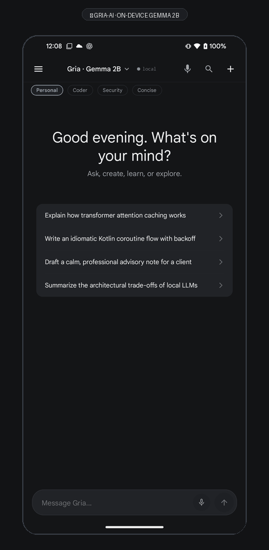
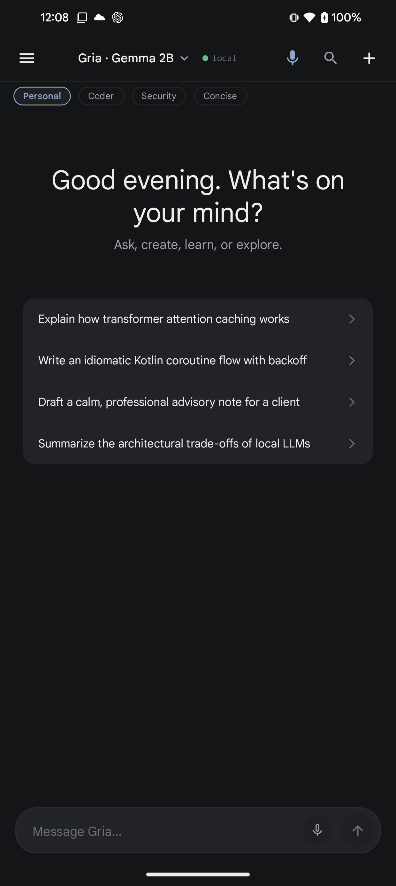
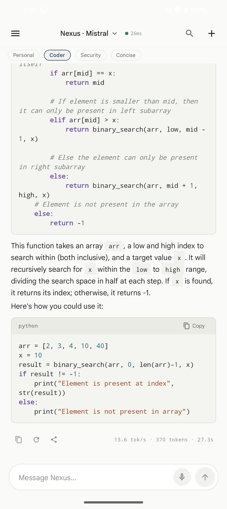
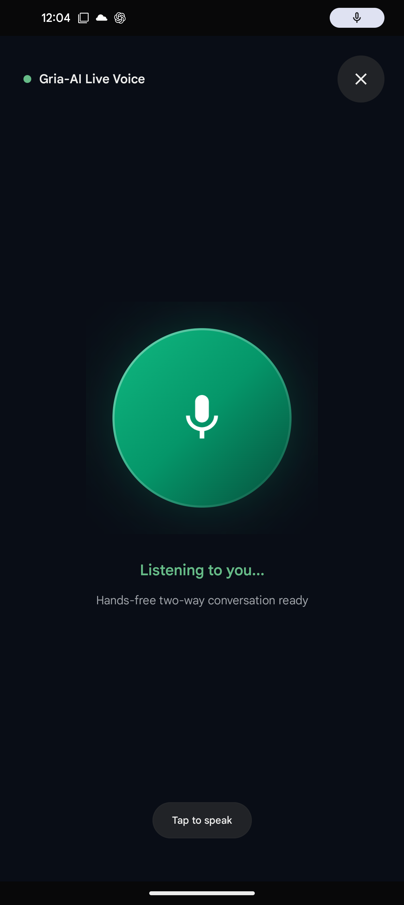
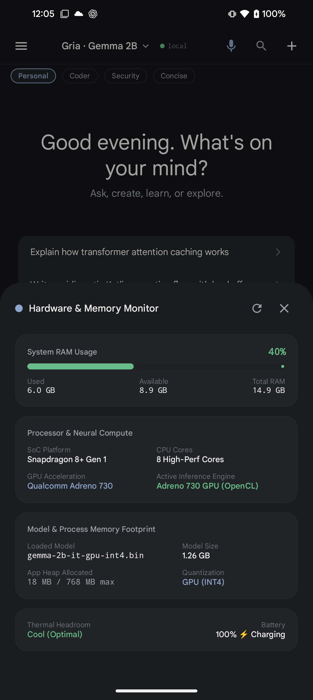
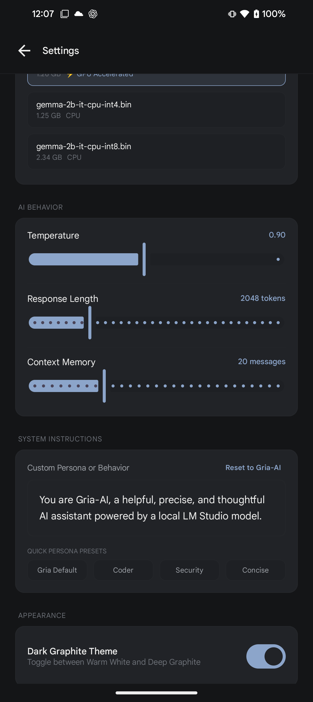
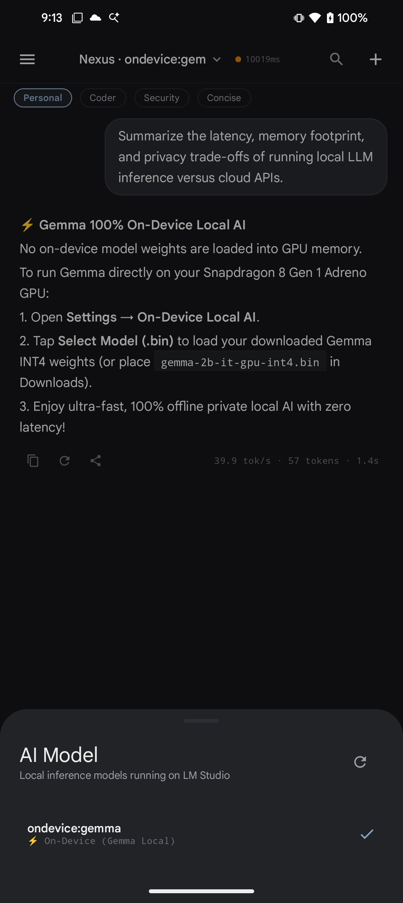
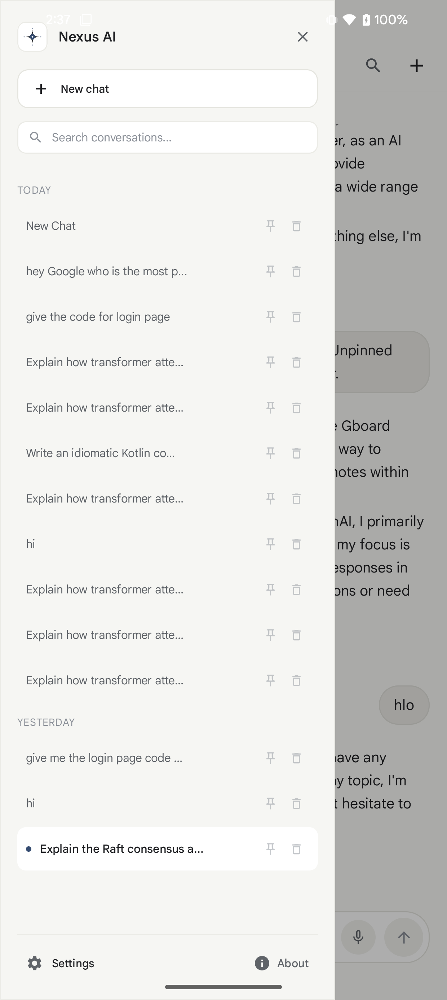
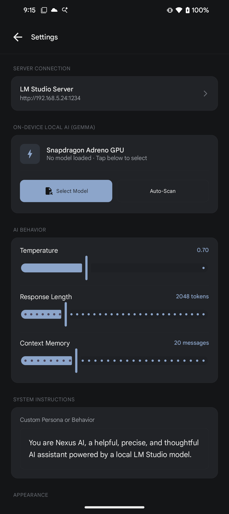
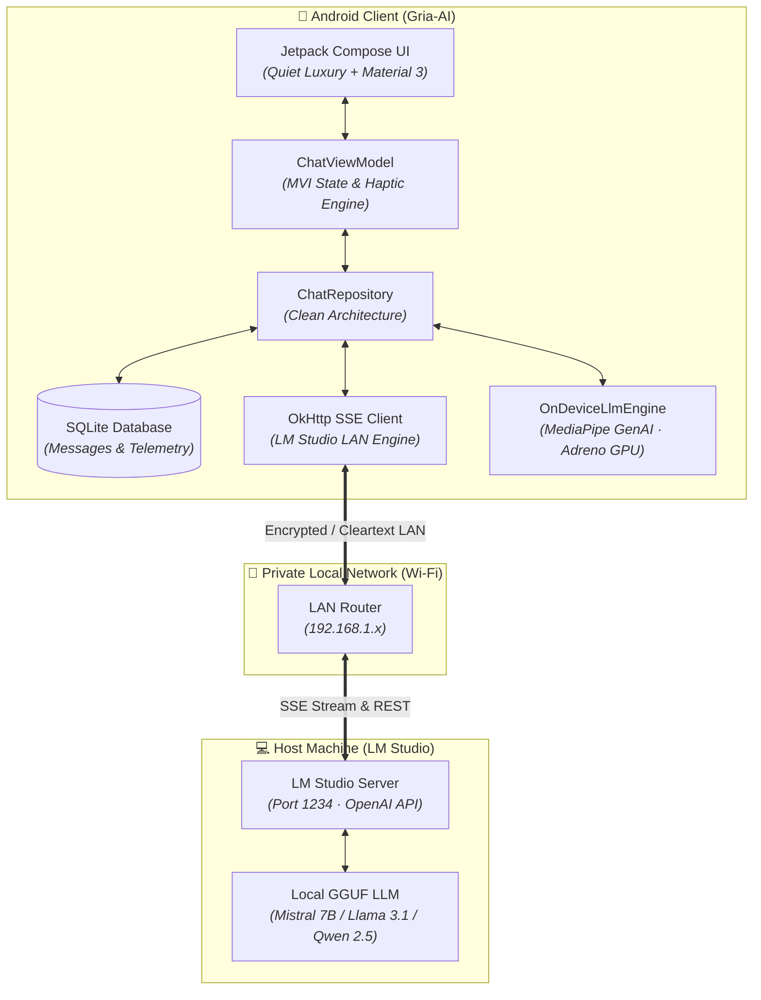

<div align="center">

# ✦ GRIA-AI ✦
### *Quiet Luxury On-Device & Local AI Assistant for Android*

A state-of-the-art, 100% private Android AI chat application delivering a ChatGPT-grade conversational experience powered directly by your own local LLMs running inside **LM Studio** on your PC.

[-3DDC84?style=for-the-badge&logo=android&logoColor=white)](https://android.com)
[](https://kotlinlang.org)
[](https://developer.android.com/jetpack/compose)
[](https://lmstudio.ai)
[](LICENSE)

<br/><br/>

<a href="#-interface-gallery">
  
</a>

<br/><br/>

[ ✨ Highlights ](#-highlights) • [ 📱 Interface Gallery ](#-interface-gallery) • [ 🏛️ Architecture ](#️-architecture) • [ 🚀 Quick Start ](#-quick-start) • [ 👨‍💻 Author ](#-author--credits)

</div>

---

## 📱 Interface Gallery

Experience the **Quiet Luxury + Modern Minimalism** design system on real Android hardware:

<div align="center">
<table>
  <tr>
    <td align="center" width="50%">
      <b>✦ Gria-AI Welcome Screen</b><br/>
      <sub>Dark Graphite palette, Gria · Gemma 2B header, and persona pills</sub><br/><br/>
      
    </td>
    <td align="center" width="50%">
      <b>💬 Code Syntax Highlighting & Live Telemetry</b><br/>
      <sub>Multi-language lexer, copy button, and tok/s performance footer</sub><br/><br/>
      
    </td>
  </tr>
  <tr>
    <td align="center" width="50%">
      <b>🎙️ Two-Way Offline Voice Assistant</b><br/>
      <sub>Hands-free voice orb with STT, on-device Gemma inference & TTS playback</sub><br/><br/>
      
    </td>
    <td align="center" width="50%">
      <b>📊 Hardware & RAM Live Monitor</b><br/>
      <sub>Snapdragon 8+ Gen 1, RAM usage gauge, Adreno 730 GPU & thermals</sub><br/><br/>
      
    </td>
  </tr>
  <tr>
    <td align="center" width="50%">
      <b>🎭 Custom Persona & Behavior Studio</b><br/>
      <sub>System prompt editor, 1-tap Reset to Gria-AI, and Quick Persona Presets</sub><br/><br/>
      
    </td>
    <td align="center" width="50%">
      <b>⚡ 100% On-Device Gemma Inference</b><br/>
      <sub>39.9 tok/s local generation directly on Snapdragon Adreno GPU</sub><br/><br/>
      
    </td>
  </tr>
  <tr>
    <td align="center" width="50%">
      <b>📚 SQLite Conversation Drawer</b><br/>
      <sub>Searchable history, pinned chats, and quick access</sub><br/><br/>
      
    </td>
    <td align="center" width="50%">
      <b>⚙️ On-Device AI & GPU Settings</b><br/>
      <sub>Model file picker (.bin/.task) and Auto-Scan Downloads</sub><br/><br/>
      
    </td>
  </tr>
</table>
</div>

---

## 🌟 Highlights

<table>
  <tr>
    <td width="50%">
      <h3>🎙️ Two-Way Offline Voice Assistant</h3>
      Full hands-free spoken conversation loop. Interactive animated glowing voice orb with on-device speech-to-text (STT), local Gemma intelligence, and offline text-to-speech (TTS) playback with haptic feedback.
    </td>
    <td width="50%">
      <h3>📊 Live Hardware & RAM Telemetry</h3>
      Real-time system telemetry bottom sheet. Live monitors Qualcomm Snapdragon 8+ Gen 1 cores, system RAM consumption gauge, model memory footprint, active Adreno 730 GPU acceleration, and thermal headroom.
    </td>
  </tr>
  <tr>
    <td width="50%">
      <h3>⚡ Real-Time Streaming & Telemetry</h3>
      Native Server-Sent Events (SSE) token delivery. Measures exact generation metrics on every assistant completion:
      <code>13.6 tok/s · 370 tokens · 27.3s</code>.
    </td>
    <td width="50%">
      <h3>🟢 Live Server & Local Engine Badge</h3>
      Top bar status pill tracks real Wi-Fi network latency directly to your LM Studio server or switches to <code>🟢 local</code> when executing on-device models.
    </td>
  </tr>
  <tr>
    <td width="50%">
      <h3>🎭 Quick Persona / Mode Presets</h3>
      Seamlessly switch system prompts without starting a new chat:
      <ul>
        <li><b>Personal AI</b>: Warm, concise daily companion</li>
        <li><b>Senior Coder</b>: Idiomatic, clean software engineer</li>
        <li><b>Security Analyst</b>: Architecture & posture auditor</li>
        <li><b>Concise Synthesizer</b>: High-density executive bullets</li>
      </ul>
    </td>
    <td width="50%">
      <h3>🎨 Quiet Luxury Syntax Highlighting</h3>
      Custom multi-language lexer supporting <b>Kotlin, Python, Bash, Rust, JavaScript, TypeScript, SQL, and JSON</b> with slate violet, terracotta, and deep teal tokens.
    </td>
  </tr>
  <tr>
    <td width="50%">
      <h3>🎙️ On-Device Voice Input</h3>
      One-tap microphone button with animated breathing halo. Launches native speech recognition modal with real-time audio waveforms.
    </td>
    <td width="50%">
      <h3>⚡ 100% On-Device Gemma LLM</h3>
      MediaPipe Tasks GenAI engine executes Google Gemma (1B / 2B) directly on the phone's Snapdragon Adreno GPU at 30-45+ tok/s with zero internet connection required.
    </td>
  </tr>
</table>

---

## 🏛️ Architecture

GRIA-AI is built strictly on **Clean Architecture + MVI/MVVM**, decoupling domain business logic from the UI presentation layer, on-device GPU inference, and LAN streaming transport.



### Tech Stack Matrix

| Layer | Technologies |
| :--- | :--- |
| **UI & Presentation** | Jetpack Compose 2024, Material 3, Edge-to-Edge, Compose Animations |
| **Architecture** | Clean Architecture (Domain, Data, Feature, Core) + MVVM / MVI |
| **Language & Concurrency** | Kotlin 2.3.20, Kotlin Coroutines, StateFlow, SharedFlow |
| **Networking & SSE** | Retrofit 2, OkHttp 4, OkHttp Server-Sent Events (`EventSource`) |
| **Serialization** | Kotlinx Serialization JSON |
| **Local Persistence** | SQLite OpenHelper with reactive Kotlin Flow change triggers |
| **Preferences** | AndroidX Preferences DataStore |
| **Hardware Integration** | `Vibrator` / `VibrationEffect` API, `SpeechRecognizer`, Audio HAL |

---

## 🚀 Quick Start

### 1. Prerequisites
- **Android Studio** (Koala / Ladybug or newer)
- **Android SDK** API 35
- Physical device or emulator running **Android 10+ (API 29+)**
- **LM Studio** installed on your PC ([lmstudio.ai](https://lmstudio.ai))

### 2. Configure LM Studio
1. Open LM Studio and load any GGUF model (e.g. `mistral-7b-instruct-v0.3`, `llama-3.1-8b-instruct`).
2. Navigate to the **Developer tab (`<->`)**.
3. Toggle **Serve on Local Network (0.0.0.0)** and click **Start Server** on port `1234`.
4. Run `ipconfig` in your PC terminal to get your IPv4 address (e.g., `192.168.1.100`).

### 3. Clone & Build
```powershell
# Clone the repository
git clone https://github.com/geevarghesekthomas84-sys/Gria-AI.git
cd Gria-AI

# Compile the debug APK
.\gradlew.bat assembleDebug

# Install onto your connected Android device
adb install -r app/build/outputs/apk/debug/app-debug.apk
```

### 4. Connect
1. Launch **Gria-AI** on your phone.
2. Tap the **Server Status Badge** in the top bar.
3. Enter your PC's IP and port (e.g. `http://192.168.1.100:1234`) and tap **Save & Apply**.
4. Tap the active model dropdown in the top bar to select your loaded model. Enjoy 100% private local AI!

---

## 👨‍💻 Author & Credits

Designed and engineered with passion by **GG** (**Geevarghese K Thomas**).

<div align="center">

[](https://github.com/geevarghesekthomas84-sys)
[](https://www.linkedin.com/in/geevarghese-k-thomas)
[](https://buymeacoffee.com/geevarghes2)

</div>

---

## 📄 License

```
Copyright 2026 Geevarghese K Thomas (GG)

Licensed under the Apache License, Version 2.0 (the "License");
you may not use this file except in compliance with the License.
You may obtain a copy of the License at

    http://www.apache.org/licenses/LICENSE-2.0
```
